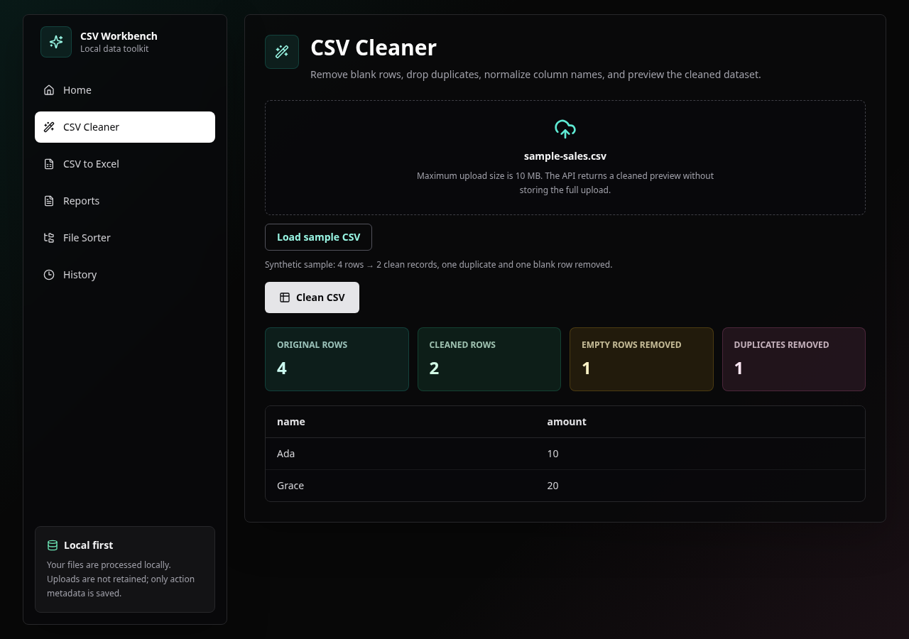
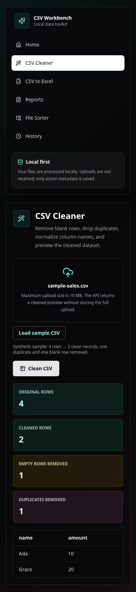

# CSV Workbench

CSV Workbench is a local-first toolkit for cleaning small CSV exports and turning them into useful files. It gives a clear before-and-after preview, creates Excel workbooks and reports, simulates file sorting, and keeps a local history of actions. Uploaded file contents are processed in memory and are not saved.

## Try the demo

The cleaner has a built-in synthetic sample, so the full workflow works without preparing a file:

1. Open **CSV Cleaner** and choose **Load sample CSV**.
2. Choose **Clean CSV** to remove one duplicate and one blank row.
3. Review the cleaned rows, then try **CSV to Excel** or **Reports**.
4. Open **History** to see the local action log.

The 10 MB file limit and local processing are shown in the interface. The screenshots below come from this working browser flow.





## Run locally

Requirements: Python 3.11 or newer and Node.js 24 (the version used by CI and Docker).

In the project root, create a virtual environment and install the backend dependencies:

```bash
python -m venv .venv
source .venv/bin/activate
pip install -r requirements-dev.txt
uvicorn app.main:app --app-dir backend --reload
```

On Windows PowerShell, activate with `\.venv\Scripts\Activate.ps1` instead. The API is at `http://127.0.0.1:8000`; its interactive docs are at `/docs`.

In another terminal:

```bash
cd frontend
npm ci
npm run dev
```

Open `http://127.0.0.1:5173`. If the API uses another address, set `VITE_API_BASE_URL` in `frontend/.env` before starting or building the frontend.

## Run with Docker Compose

```bash
docker compose up --build
```

The web and API ports bind to loopback. Compose stores the SQLite history and generated exports in separate named volumes; keep those volumes when recreating containers. The API container runs as an unprivileged user.

## What it demonstrates

- CSV cleanup with row counts, normalized column names and a data preview
- CSV-to-XLSX conversion and downloadable text or HTML reports
- File sorting simulation that does not move files
- A local SQLite action history
- FastAPI, Pandas, React, TypeScript and a small set of focused data-processing tests

The app has no user authentication. Keep it on your own machine; do not expose it as a shared service without adding access controls and retention rules.

## Data and storage

By default, SQLite history is stored in `backend/data/toolkit.db` and temporary exports use `backend/generated/`. Set `AUTODESK_DATA_DIR` or `AUTODESK_GENERATED_DIR` before starting the backend to select other folders. Docker Compose maps persistent volumes to `/app/data` and `/app/generated`.

The database stores action metadata (date, operation, file name and summary counts), not the uploaded CSV contents. Downloads are temporary and removed after the response is sent.

### Upgrade an existing Docker installation safely

Older Compose versions persisted exports only: the history database lived inside
the backend container. **Do not recreate or remove that container before copying
its data.** Keep the same Compose project name so the existing export volume is
retained. The new `toolkit-history` volume is separate from `toolkit-data`.

Stop writes, copy the entire SQLite directory (including any WAL files), then
create a verified snapshot. Run these commands from the repository root with the
old container still present; `docker compose cp` also works on a stopped container:

```bash
docker compose stop backend
mkdir -p backups/legacy
docker compose cp backend:/app/data/. backups/legacy/
python backend/app/migrate_history.py backups/legacy/toolkit.db backups/toolkit.db
```

The migration prints the copied row count, checks SQLite integrity and the history
schema, and refuses to replace an existing target. Keep both copies until you
have verified the History page after restart. If the old deployment used a custom
`AUTODESK_DATA_DIR`, copy that directory instead of `/app/data`.

Build the updated image and initialize the new history volume from the snapshot:

```bash
docker compose build backend
docker compose run --rm --no-deps --user root -v "$PWD/backups:/backup:ro" backend sh -c 'python -m app.migrate_history /backup/toolkit.db /app/data/toolkit.db && chown 10001:10001 /app/data/toolkit.db'
docker compose up -d --build
```

If the destination already exists, migration stops without modifying it. Inspect
and back up that installation before deciding which history to retain; do not
delete it to bypass the check. Recreate the backend once more and verify the same
history rows remain. Never use `docker compose down -v` when retaining data.
For rollback, keep the verified snapshot and use the same migration command to
restore it into an **empty** data directory used by the previous code. The current
history schema is unchanged. Local installations can use the Python command with
their old and new database paths while the application is stopped.

## Checks

From the repository root:

```bash
ruff check .
python -m pytest -q
cd frontend
npm run lint
npm run typecheck
npm run security:check
npm run build
```

The backend suite covers literal XLSX cells and headers, recovery from a validated SQLite snapshot, WAL data, restart persistence, and failures that must preserve existing data. The browser scenario drives the built app through sample cleaning, history, XLSX and report downloads, file sorting, accessibility checks and history clearing. To reproduce it, build with the API address used by the test and install the E2E requirements:

```bash
cd frontend
VITE_API_BASE_URL=http://127.0.0.1:18320 npm run build
cd ..
python -m pip install -r e2e/requirements.txt
PLAYWRIGHT_CHROMIUM_EXECUTABLE_PATH=/path/to/chromium E2E_API_PYTHON="$(pwd)/.venv/bin/python" .venv/bin/python -m pytest -q e2e
```

The E2E run uses temporary database and export folders and writes fresh browser screenshots to `docs/screenshots/`. Chromium's sandbox stays enabled. CI uses the Ubuntu runner's system Chrome, whose path is supported by the runner's AppArmor policy. When local container isolation prevents the browser sandbox from starting, use a host with a working Chromium sandbox rather than disabling it.

## Naming

The original repository name suggests a connection to Autodesk, Inc.; there is none. The product and API are now named CSV Workbench. See [the naming note](docs/NAZWA.md).

## License

MIT. See [LICENSE](LICENSE).
